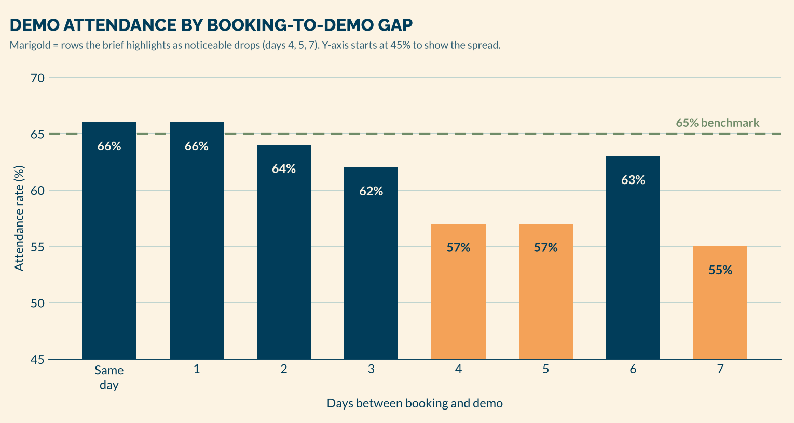

# Bhanzu Growth PM Case Study — Demo Attendance

**Candidate:** Abhinav Chaudhary

**Package:** this document · working prototype (`dist/index.html`, run instructions in `README.md`) · supporting docs in `docs/`

| If you want… | Read |
|---|---|
| The answer to Parts 1–4 | This document |
| What the prototype does and how it was built | `README.md`, `docs/PRODUCT_SPEC.md` |
| How the test would run and be decided | `docs/EXPERIMENT_PLAN.md` |
| Event definitions and privacy | `docs/ANALYTICS_PLAN.md` |
| What was checked, how, and the results | `docs/VERIFICATION_REPORT.md` |
| What changed from the first version and why | `docs/QUALITY_AUDIT.md` |
| Short answers to likely challenges | `docs/INTERVIEW_DEFENSE.md` |

---

## Executive summary

- **Data.** Attendance is 66% for same-day and next-day bookings and 55% at a 7-day gap, an 11-point spread. The pattern is not a smooth slope: a 5-point step between day 3 and day 4, a plateau at 57%, a rebound to 63% at day 6, and the low at day 7.
- **What it can't tell us.** The table has no booking counts, so we cannot compute confidence intervals, test significance, or reconstruct the overall rate. It is observational, so it cannot show that waiting *causes* no-shows; who books later may differ from who books same-day.
- **The larger problem.** Even the best rows lose one booking in three. The gap explains part of the loss; most of it exists at every gap.
- **Diagnosis.** A decision made in an ad-click moment has to survive forgetting, competing priorities, a child who wasn't part of the decision, doubts about a sales pitch, and joining friction. Today nothing gives the family a reason to re-engage during the wait.
- **Recommendation, in two parts.**
  1. **Baseline (ship to everyone, no test needed to justify it):** rewritten confirmation and reminder messages, one-tap rescheduling, calendar and joining help.
  2. **Primary learning experiment:** the **Math Mission**, a 5-minute, child-facing warm-up sent with the confirmation, plus a parent preparation hub. It is the most uncertain and potentially most valuable idea, and the only one that works through the child.
- **Measurement.** Primary metric: demo attendance, intent-to-treat, using Bhanzu's existing attendance definition. Leading indicator: **24-hour Math Mission activation rate** among treatment bookings with at least 24 hours to the demo, first read on day 3 of the test.

---

## Part 1 — Reading the data

### 1.1 The data

Every figure below was checked against the brief (table on page 2; rows 4, 5 and 7 are shaded orange in the original). No discrepancies.



| Days between booking and demo | Attended | No-show | vs 65% benchmark | vs same day |
|---|---:|---:|---:|---:|
| 0 (same day) | 66% | 34% | +1 pt | — |
| 1 | 66% | 34% | +1 pt | 0 |
| 2 | 64% | 36% | −1 pt | −2 pts |
| 3 | 62% | 38% | −3 pts | −4 pts |
| **4** | **57%** | **43%** | **−8 pts** | **−9 pts** |
| **5** | **57%** | **43%** | **−8 pts** | **−9 pts** |
| 6 | 63% | 37% | −2 pts | −3 pts |
| **7** | **55%** | **45%** | **−10 pts** | **−11 pts** |

Bold rows are the ones the brief shades orange ("attendance dropped noticeably").

### 1.2 What the data tells us — and what it does not

**Observed facts** (read directly from the table)
1. Days 0 and 1 are the best rows at 66%, 1 point above the 65% benchmark.
2. Days 2 and 3 fall 2 points each (64%, 62%).
3. Day 3 → day 4 is the largest single step: −5 points.
4. Days 4 and 5 are equal at 57%.
5. Day 6 is 63%, 6 points above days 4–5.
6. Day 7 is the lowest at 55%, 11 points below same-day.
7. No-shows rise from 34% to 45% between day 0 and day 7, about a third more (11 ÷ 34 ≈ 32% relative).
8. The simple average of the eight rows is 61.25%. That is not comparable to the 65% benchmark (see 1.3).

**Interpretations** (what the facts suggest, with the reasoning shown)
- **The pattern is a step, not a slope.** Days 0–3 lose 4 points across three days; days 3–4 lose 5 in one. Something changes around the 4-day mark. It may be a feature of the calendar (e.g. a weekend falling inside the wait), of the reminder cadence, or of who books four or more days out.
- **The day-6 rebound rules out a simple "people forget over time" story.** Forgetting alone would produce a monotonic decline.
- **The floor matters at least as much as the slope.** The best row loses a third of bookings. A fix aimed only at long gaps leaves most of the loss untouched.
- **The gap is operationally expensive even before we know why.** If booking costs are equal, the cost per *attended* demo is cost per booking ÷ attendance rate, so a 7-day booking costs 66 ÷ 55 = 1.2×, i.e. about 20% more per attended demo than a same-day booking. Per 1,000 bookings, the 7-day rate means about 110 more empty seats than the same-day rate. Those are teacher slots booked and unused, and counsellor capacity planned for families who never arrive.

**Hypotheses** (plausible explanations, none established)

| Pattern | Candidate explanations |
|---|---|
| Step at day 4 | A weekend falls between booking and demo more often at 4+ days; the current reminder schedule leaves a long silent stretch; nearer slots were full, pushing some families (possibly lower-intent) to day 4+ |
| Day-6 rebound | Weekday alignment: if demos cluster on weekends, 6-day bookings may be disproportionately weekend-to-weekend plans (book Sunday for Saturday) made by deliberate planners; a specific campaign or market; slot supply; noise from a small row |
| Day-7 low | "Same time next week" bookings that are a soft yes; possibly a default option in the booking UI |
| 34% floor | Impulse bookings, wrong contact details, the child not on board, joining problems, no concrete plan for the hour |

**Unknowns that block stronger conclusions**
- **Booking counts per row.** Without them we cannot compute confidence intervals or test whether rows differ. For scale only: *if* a row had about 200 bookings, a 95% interval would be about ±7 points, enough to make the day-6 rebound indistinguishable from noise. We do not know the counts, so this is an illustration, not a finding.
- **How the 65% is computed.** It is described as "approximately 65%" across all bookings. It may cover a different period or include gaps beyond 7 days.
- **How "attended" is defined** (any join, or a minimum duration) and how cancellations, reschedules and duplicates are counted.

### 1.3 Unweighted average vs weighted overall rate

The overall attendance rate is a **booking-weighted** average: each row counts in proportion to its number of bookings. The 61.25% simple average gives every row equal weight, so it is not an estimate of the overall rate.

Taken at face value, an overall rate of 65% with every row from day 2 onward at 64% or below would mean **at least half of all bookings sit in the day 0–1 rows** (the 66% rows must pull the average up to 65%). But the figures are rounded to whole percentages. If the true values were, say, 65.5% for days 0–1, 64.49% for day 2 and 64.5% overall, the bound collapses to almost nothing. So the table **suggests**, but cannot show, that short-gap bookings dominate volume. The row counts settle it, and the answer changes prioritization: if long-gap bookings are a small share of volume, gap-specific fixes have a small ceiling.

### 1.4 Treating 65% as a planning baseline

The brief calls 65% "our current benchmark". I use it only for planning (e.g. illustrative sample-size inputs). The experiment's control rate will be measured in the control arm itself, after the baseline message changes ship, and may differ.

### 1.5 Breakdowns needed to separate cause from cohort mix

| Breakdown | What it would reveal |
|---|---|
| Gap × **demo weekday** and × **booking weekday** | Whether the day-4 step and day-6 rebound are calendar effects |
| Gap × **time of day** of the demo | Evening congestion vs weekend slots |
| Gap × **slot availability** (earliest slot offered vs slot chosen) | Whether later bookers chose to wait or had to (selection vs supply) |
| Gap × **lead source / campaign / market** | Whether long gaps come from particular audiences or time zones |
| Gap × **reminder exposure** (delivered, read) | Whether long-gap families simply received fewer or worse-timed messages |
| Gap × **reschedule / cancel history** | Whether "no-shows" include failed attempts to reschedule |
| Gap × **join-link clicks vs actual joins** | Technical friction vs lost intent |
| Gap × **child age band**, first-time vs returning visitor | Segment differences |
| **Attendance → enrollment** by gap | Whether a long-gap attendee is worth more or less, which sizes the prize |

---

## Part 2 — Diagnosing the drop

### 2.1 Do I agree with the team?

**"Attendance falls as the booking gap grows."** Partly. Days 0–1 average 66%; days 4–7 average 58%. But the decline is not monotonic, and the gap is likely a proxy for other things: the weekday the demo falls on, how the slot was chosen, and who the family is. I would use the gap to *target* interventions, not treat it as the cause.

**"A 5-day booker is no different from a same-day booker."** I disagree. Clicking and booking are cheap; attending costs an evening. The chosen date is the family's first signal of how the demo fits their life:
- **Same-day bookers** act on live intent, probably with the child nearby. Intent is high but fragile.
- **Five-day bookers** are a mix: planners who picked a slot that works (possibly *higher* commitment), soft yeses who picked a later date because nothing felt urgent, and families who had no nearer slot.
- **Their context differs**: more days for exams, tuition, illness, travel, or a family member questioning the decision.

So part of the day-5 shortfall is caused by waiting and part by who chooses to wait. A randomized experiment on the waiting period isolates the first part; the breakdowns in 1.5 estimate the second.

### 2.2 What happens between booking and session

The booking is made in a warm moment ("I want my child to enjoy maths"). Attendance happens in a cold one ("it's 5:30, he's tired, I'm cooking, is this a sales pitch?"). Forces against attendance as time passes:

1. **Memory decay.** One booking among dozens of things that day; without well-timed cues it is forgotten.
2. **Present bias and competing priorities.** On the day, homework, tuition and chores feel more urgent than an optional free class.
3. **Fading emotional intent.** The ad created a feeling; by day 5 only the cost (an hour) is left.
4. **Zero sunk cost.** Nothing has been invested, so skipping costs nothing.
5. **Second thoughts.** Fear of sales pressure, doubts about online maths, an unconvinced family member; more days means more time for doubt and comparison.
6. **The child isn't on board.** The parent booked it; the child may not know, or may resist "extra maths". The child is the one who has to attend.
7. **Logistics.** Which device, which link, will it work. Friction that appears in the last 15 minutes is often fatal.
8. **Silence.** Nothing between confirmation and a last-minute reminder renews the commitment.

### 2.3 Hypothesis tree

```
Why do booked families not attend?
├── A. They forget or deprioritize it
│   ├── A1 Forgetfulness
│   └── A2 Competing priorities on the day
├── B. The timing stops working
│   └── B1 Scheduling conflicts that arise after booking
├── C. Motivation fades
│   ├── C1 Loss of urgency
│   ├── C2 No interaction after booking
│   └── C3 The child is not motivated or involved
├── D. Doubt grows
│   ├── D1 Uncertainty about what the demo is
│   └── D2 Low trust / fear of a sales pitch
├── E. They try but cannot join
│   └── E1 Technical and joining difficulties
└── F. They were never very committed
    └── F1 Intent differs between gap cohorts (selection)
```

### 2.4 Hypotheses, evidence and tests

| # | Hypothesis | Why plausible | Evidence that would support it | Data to test it | Intervention it suggests | If it's wrong |
|---|---|---|---|---|---|---|
| A1 | Forgetfulness | Booking happens mid-scroll; nothing anchors it | No-shows with unread reminders; "I forgot" replies | Reminder delivery/read × outcome; one-question no-show survey | Better-timed reminders; calendar add | We over-message engaged parents; opt-outs rise |
| A2 | Competing priorities | Crowded evenings; a free class is easiest to drop | Lower attendance for weekday evenings and exam weeks | Attendance × slot time, weekday, school calendar | Better default slots; easy rescheduling; plan the hour | Slot changes ops can't staff |
| B1 | Scheduling conflicts | Longer gaps leave more room for new commitments | Reschedule requests rise with gap; "something came up" replies | Reschedule/cancel × gap | One-tap reschedule, offered proactively | Rescheduling becomes indefinite deferral |
| C1 | Loss of urgency | Ad-driven intent decays; fits the day-4 step | Engaged families attend more *at the same gap* | Engagement × attendance, controlling for gap | Engagement during the wait | Engagement may only mark intent (selection) |
| C2 | No interaction after booking | The flow is silent between confirmation and reminder | Families who click/reply to confirmation attend more | Confirmation click/reply × outcome | Something worth opening during the wait | We build content nobody opens |
| C3 | Child not involved | The child attends but rarely chose to | No-show reasons mentioning the child | Survey; attendance × age | Child-facing warm-up with a reason to show up | Children engage but parents still skip |
| D1 | Uncertainty about the demo | Parents don't know what the hour involves | Pre-demo support questions; lower attendance among first-time buyers | Support logs; landing analytics | "What to expect" content | Extra reading with little effect |
| D2 | Fear of a sales pitch | Free demo + counsellor call is a familiar pattern | No-shows concentrated in low-familiarity segments | Survey; source segmentation | Honest framing of the counsellor call | Softer framing may lower later conversion |
| E1 | Joining difficulties | Lost links, app installs, audio | Link clicks without a join; support tickets in the first 10 minutes | Join funnel: click → join → 10 min | Readiness checklist; T−30 and T+5 messages | Fixes only a small slice |
| F1 | Intent differs by cohort | Later bookers may be lower intent or forced late | Chosen-later and forced-later cohorts attend differently | Slot offered vs chosen; gap × weekday | Show soonest slots first; gap-tailored touchpoints | If intent explains everything, fix top-of-funnel quality instead |

### 2.5 Problem statement

> Parents book a free demo in a moment of emotional intent, then wait up to a week with no reason to re-engage. Forgetting, competing priorities, an uninvolved child, and doubts about the demo erode the decision. About one in three booked demos is lost, and about 45% of demos booked a week ahead.

### 2.6 Testable hypothesis

> **If** booked families receive a short, child-facing Math Mission with their confirmation, plus a parent preparation hub, **then** demo attendance will be higher than with the improved confirmation and reminders alone, **because** the child gains anticipation and a reason to show up (a badge for the teacher), the parent gets a reason to reopen the booking during the wait, and joining friction is handled before the day. We expect a larger effect at gaps of 3+ days.

---

## Part 3 — Ideas to improve attendance

### 3.1 The options

| # | Idea | What it is | Behavioural lever |
|---|---|---|---|
| 1 | Rebuilt confirmation and reminder sequence | Personal WhatsApp messages at booking, day before, 30 min before, and T+5 if not joined | Timely cues; implementation intentions; less friction |
| 2 | **Math Mission** | 5-minute puzzle set by age band; a badge to show the teacher; a summary for teacher and counsellor | Anticipation; small investment (IKEA effect); child as advocate; endowed progress |
| 3 | One-tap rescheduling | "Pick a new time" in every message and on the hub | Turns silent no-shows into reschedules; keeps intent alive |
| 4 | Parent reassurance and preparation | What happens before, during and after; honest note on the counsellor call | Uncertainty reduction; trust; autonomy |
| 5 | Calendar and joining readiness | Add to calendar, device checklist, how to join | Externalized memory; friction removal |
| 6 | Gap-aware booking | Show soonest slots first; extra touchpoint for 3+ day gaps | Defaults; shorter decay window |
| 7 | Re-engage silent families | A personal check-in if no click/reply within 48h and gap ≥3 | Personal accountability; reciprocity |
| 8 | Commitment step | "Tap I'll be there" the day before | Commitment and consistency |

### 3.2 Two decisions, two lenses

The first version of this case scored all eight ideas on one 25-point scale and then picked the 18-point Math Mission over the 21-point reminder sequence. That looked contradictory, because the table mixed two separate decisions:

1. **What should we ship now?** The question is "is it safe, cheap and very likely to help?" Confidence and effort dominate.
2. **What should we test first?** The question is "where is the most valuable uncertainty we can resolve quickly?" An idea we are already confident in has little to learn from a test.

The scores below keep the original judgements where they still hold and add the second lens. Every score is a judgement from the brief and general product experience, not measured data; the evidence column says what each rests on.

#### Lens A — readiness to ship (decides the baseline)

Criteria, 1–5 each, 5 is best: **Impact** (likely effect on attendance), **Confidence** (how well-established the mechanism is), **Effort** (5 = low), **Risk** (5 = low).

| # | Idea | Impact | Confidence | Effort | Risk | Total /20 | Evidence for the scores | Decision |
|---|---|---:|---:|---:|---:|---:|---|---|
| 1 | Reminder sequence | 3 | 4 | 5 | 4 | **16** | Reminders are standard practice for appointments; copy-only change | **Baseline** |
| 5 | Calendar + joining | 2 | 4 | 5 | 5 | **16** | Removes known friction; link and checklist are trivial to build | **Baseline** |
| 3 | One-tap reschedule | 3 | 4 | 4 | 4 | **15** | Turns some no-shows into reschedules; depends on slot supply | **Baseline** |
| 8 | Commitment step | 2 | 3 | 5 | 3 | **13** | Cheap; can feel transactional | **Baseline** (button inside the day-before message) |
| 4 | Parent reassurance | 2 | 3 | 5 | 5 | **15** | Content-only; uncertain size of effect | Folded into the Math Mission hub |
| 2 | Math Mission | 4 | 2 | 3 | 4 | **13** | Only child-facing lever, but no internal evidence families will open it | Test (Lens B) |
| 6 | Gap-aware booking | 3 | 2 | 3 | 3 | **11** | Day-6 pattern unexplained; touches booking conversion | Analyse first |
| 7 | Re-engage silent families | 3 | 3 | 2 | 3 | **11** | Human time per booking; costly at scale | Later, on the silent segment |

The Math Mission ranks low on readiness to ship, and that is correct: we should not roll it out to everyone on faith.

#### Lens B — value of testing first (decides the experiment)

Only ideas *not* already in the baseline compete here (the baseline ships to both arms, so testing it inside this experiment is impossible).

Criteria, 1–5: **Incremental impact if it works** (on top of the baseline), **Learning value** (how much uncertainty the test resolves and how much it would change future decisions), **Signal speed** (how soon a leading indicator appears), **Test cost** (5 = cheap), **Risk** (5 = low).

| Idea | Incr. impact | Learning value | Signal speed | Test cost | Risk | Total /25 | Evidence for the scores |
|---|---:|---:|---:|---:|---:|---:|---|
| **Math Mission (+ hub)** | 4 | 5 | 4 | 3 | 4 | **20** | Tests whether the child is a lever at all, a question no other idea answers; activation is visible within 24h; prototype already built |
| Gap-aware booking | 3 | 4 | 2 | 2 | 2 | **13** | Needs attendance data to read (no fast proxy); changes the booking page, which risks booking conversion |
| Re-engage silent families | 3 | 3 | 3 | 2 | 3 | **14** | Effect plausible but cost scales with bookings; better tested after the mission identifies who stays silent |

**Why the Math Mission is the right first test**
1. It is the only idea that acts on the child, who is the person who has to attend.
2. It fills the silent window with a reason to come back.
3. It produces a leading signal within a day.
4. It carries into later funnel stages: the teacher can open with the badge; the counsellor can start from what the child did.
5. Content and copy can change without engineering, so iteration is cheap.

**Risks and dependencies:** families must open it (delivery and copy matter); teachers and counsellors must use the summary for the carry-over benefit; children's data rules constrain what we track (`docs/ANALYTICS_PLAN.md` §6).

**When to revisit this decision**
- Row counts show long-gap bookings are a large share of volume and slot supply drives the gap → move gap-aware booking up.
- Join-funnel data shows many no-shows clicked the link but failed to join → prioritize joining support.
- WhatsApp delivery or read rates are poor → fix the channel before testing anything delivered through it.
- The mission's 24-hour activation stays very low after two rounds of copy changes → stop and move to re-engagement.

### 3.3 Sequence

| When | What |
|---|---|
| Week 0 | Pull the breakdowns in 1.5; confirm the attendance definition |
| Week 1 | Ship the baseline (messages 1, 3, 4, T+5 rescue, 5; rescheduling; calendar/joining) to all bookings. If leadership wants its effect measured, run it as its own short A/B against today's flow first; do not stack it into the mission test |
| Week 2+ | Launch the Math Mission experiment on top of the baseline |

### 3.4 Message copy

All messages are proposed **WhatsApp Business template** messages. **None is implemented**; the prototype only demonstrates the experience the links open. Production needs template approval, opt-in, quiet hours (no sends 9 pm–8 am local), a per-booking message cap, and a STOP option. `{{fields}}` come from the booking system.

**Arm assignment:** baseline messages go to both arms. Message 2 and the mission link/button in Message 1 are treatment-only.

---

#### Message 1 — Booking confirmation
- **Timing:** within 1 minute of booking · **Audience:** every new booking
- **Purpose:** confirm details, set the plan, give the child something to do now
- **Mechanism:** uncertainty reduction; immediate reward; plants the mission while intent is warm
- **Fields:** `parent_first_name`, `child_first_name`, `demo_day`, `demo_date`, `demo_time`, `timezone`, `age_band`, `mission_link`, `details_link`
- **Desired action:** tap *Start Math Mission* (treatment) or *Add to calendar*

> Hi {{parent_first_name}} 👋
>
> {{child_first_name}}'s free Bhanzu maths class is booked!
>
> 📅 {{demo_day}}, {{demo_date}}
> ⏰ {{demo_time}} ({{timezone}})
> 💻 60 minutes, live with a teacher
>
> While you wait, {{child_first_name}} can try a 5-minute Math Mission made for ages {{age_band}}. It's a fun warm-up with a secret speed trick, not a test.
>
> 👉 {{mission_link}}
>
> Need a different time? Just reply CHANGE.
>
> [ Start Math Mission ] [ Add to calendar ] [ Change time ]

*Control version:* identical, without the Math Mission paragraph and button; the link goes to a plain details page.

---

#### Message 2 — Early engagement invitation (treatment only)
- **Timing:** 24 hours after booking (after the leading-indicator window closes) · **Audience:** treatment bookings with no `mission_started`, demo at least 24 hours away
- **Purpose:** a second reason to open the booking during the wait
- **Mechanism:** curiosity; the child as advocate; small ask
- **Fields:** `parent_first_name`, `child_first_name`, `demo_day`, `mission_link`
- **Desired action:** child starts the mission

> Hi {{parent_first_name}}, a quick one for {{child_first_name}} 🙂
>
> We've made a 5-puzzle Math Mission to warm up before {{demo_day}}'s class. At the end, {{child_first_name}} gets a badge to show the teacher.
>
> It takes about 5 minutes. A good one for after homework 👇
> {{mission_link}}

**Variant for families who completed the mission:**

> 🏅 {{child_first_name}} earned the {{badge_name}} badge!
>
> Bring it to class on {{demo_day}} at {{demo_time}}; {{child_first_name}} can tell Ms. {{teacher_first_name}} about it at the start.
>
> A 2-minute read on getting the most out of the class: {{prep_link}}

---

#### Message 3 — Day-before reminder
- **Timing:** 6 pm local the day before (same-day bookings: merged into Message 4) · **Audience:** all confirmed bookings
- **Purpose:** renew commitment, plan the hour, surface conflicts early enough to reschedule
- **Mechanism:** implementation intention (where, which device); rescheduling easier than skipping; one-tap commitment
- **Fields:** `child_first_name`, `demo_time`, `join_link`
- **Desired action:** *I'll be there* or *Change time*

> Tomorrow's the day! 🎉
>
> {{child_first_name}}'s live maths class is at {{demo_time}}.
>
> Three small things help:
> 1️⃣ A laptop or tablet works best (a phone is fine too)
> 2️⃣ A quiet corner, a pencil and paper
> 3️⃣ Join 5 minutes early. The link: {{join_link}}
>
> Something came up? No problem, just pick a new time.
>
> [ I'll be there 👍 ] [ Change time ]

**Hinglish variant**

> Kal class hai! 🎉
>
> {{child_first_name}} ki live maths class kal {{demo_time}} baje hai.
>
> Bas teen cheezein:
> 1️⃣ Laptop ya tablet best rahega (phone bhi chalega)
> 2️⃣ Ek shaant jagah, pencil aur copy
> 3️⃣ 5 minute pehle join karein: {{join_link}}
>
> Kuch aa gaya? Koi baat nahi, naya time chun lijiye.
>
> [ Hum aayenge 👍 ] [ Time badlein ]

---

#### Message 4 — Short pre-demo reminder
- **Timing:** 30 minutes before · **Audience:** all confirmed bookings
- **Purpose:** the link at the moment of action; catch technical problems early
- **Mechanism:** cue at the point of action; human safety net
- **Fields:** `child_first_name`, `teacher_first_name`, `join_link`
- **Desired action:** tap the link; reply HELP if stuck

> {{child_first_name}}'s class starts in 30 minutes ⏰
>
> Ms. {{teacher_first_name}} is getting ready. Join here: {{join_link}}
>
> Trouble joining? Reply HELP and our support team will get in touch.

**T+5 minutes, not joined (live rescue):**

> We've started! {{child_first_name}}'s seat is still open. Join here: {{join_link}}
>
> If today doesn't work anymore, reply CHANGE and we'll find another time.

---

#### Message 5 — Rescheduling and recovery
- **Timing:** 30–60 minutes after the class ends, no join recorded · **Audience:** no-shows and anyone who replied CHANGE
- **Purpose:** turn a lost booking into a rebooked one without blame
- **Mechanism:** no guilt; very low effort; continuity; soonest slots first
- **Fields:** `parent_first_name`, `child_first_name`, `slot_1`–`slot_3`, `badge_name` (if earned)
- **Desired action:** reply 1, 2 or 3

> Hi {{parent_first_name}}, we missed {{child_first_name}} in class today. Completely understandable, days with children get busy.
>
> Would one of these times work instead?
>
> 1️⃣ {{slot_1}}
> 2️⃣ {{slot_2}}
> 3️⃣ {{slot_3}}
>
> Reply 1, 2 or 3 and it's booked. {{child_first_name}}'s {{badge_name}} badge is saved for the new class.
>
> If now isn't the right time for classes, reply STOP and we won't message about this booking again.

**Copy principles:** short; the child's name; no fake urgency or guilt; honest about the counsellor call; always an easy way out, because a family that reschedules is recoverable and a family that feels trapped is not.

---

## Part 4 — The micro-experience: Bhanzu Math Mission

**Prototype:** `dist/index.html` (single file, opens in any browser) or `npm run dev`. A clearly labelled concept prototype; booking, teacher and slots are sample data and nothing is sent anywhere.

### 4.1 Why this idea

Covered in 3.2: it is the most valuable uncertainty to resolve, the only child-facing lever, fast to read, and it carries into the demo and the counsellor call. It also delivers ideas 3, 4 and 5 (reschedule, reassurance, joining help) in one place.

### 4.2 What the parent and child see and do

1. **Home.** A yellow child panel: "Hi Aarav! Your math class is in 3 days." with *Start Math Mission* ("About 5 minutes · Not a test · No sign-up"). Below, the parent card: date, time with time zone (e.g. "5:30 pm IST"), length, teacher, **Confirmed** status, a live countdown, and *How to join*, *Get ready for class*, *Change time*. A timeline: Mission → Live demo → Counsellor call → You decide (no obligation).
2. **Pick your mission.** Three cards explain how it works (5 puzzles, hints if stuck, a badge for the teacher). The child picks an age band (6–8, 9–11, 12–14). No exact age is asked.
3. **Mission.** Five puzzles, easiest first, ending with a speed trick. Progress bar and dots.
4. **Feedback.** Right: ✓ and praise plus a one-line explanation. First miss: ✗, "Not quite, and that's okay", a hint, try again. Second miss: the answer and explanation, then move on. Typed answers are validated with child-friendly messages.
5. **If the family is interrupted.** Leaving or refreshing keeps progress; home shows *Continue mission (2 of 5 done)*.
6. **Completion.** Badge, 1–3 stars (never zero), a puzzle-by-puzzle summary, *Play again* / *Try another level*, and "Tell Ms. Kavya about your badge when class starts on Saturday at 5:30 pm IST."
7. **Parent note.** Which skills needed help, and how the summary would reach the teacher and counsellor in production (not sent in the prototype).
8. **Get ready for class.** What to expect before, during and after; five tips; FAQ including "Will I be pushed to buy something?".
9. **How to join.** Steps, a join button that explains when the real link would open, a readiness checklist, *Add to Google Calendar* (opens Google Calendar prefilled; nothing is saved unless the parent saves it), copyable details, *Can't make it?*.
10. **Change time.** Soonest slots first, a required choice, confirm; the home card shows **Rescheduled** and the new countdown.

Reviewer tools: **Event log** (top right) shows each tracked event with its pseudonymous booking ID; the footer switches the sample booking gap (same day, 1, 3, 5, 7 days); *Reset prototype* clears everything. A link with unreadable booking data (e.g. `?demo=next-tuesday`) shows a notice and a sample booking instead of failing silently.

### 4.3 The one early signal: 24-hour activation rate

| | Definition |
|---|---|
| **Numerator** | Treatment bookings in the denominator with at least one `mission_started` event within 24 hours of Message 1 being delivered |
| **Denominator** | Eligible treatment bookings whose Message 1 was delivered **and** whose demo starts at least 24 hours after delivery |
| **Window** | Fixed 24 hours from delivery, for everyone in the denominator |
| **Short-notice bookings** (< 24 h to demo) | Excluded from this metric; reported separately as *pre-demo activation* (started before the demo). Never pooled, because their windows differ |
| **First read** | Day 3 of the test: bookings from days 1–2 have complete windows |
| **Activation vs completion** | Activation (started) tells us whether delivery and the hook work. Completion (`mission_completed` ÷ starters) tells us whether the content works. Both are tracked; activation is the gate |

**Why a fixed 24 hours rather than "72 hours or before the demo, whichever is first":** that earlier rule gave a 4-day booking three days to activate and a next-day booking a few hours, so the metric would rise or fall with the gap mix instead of with the product. A fixed window makes every booking in the denominator comparable. Message 2 is sent at hour 24, so the 24-hour rate measures the confirmation hook alone.

**Decision rules for the day-3 read** (thresholds are proposals to agree before launch, not predictions):
- Activation **below 15%**: the hook or delivery is failing. Fix copy, button, timing; restart the cohort clock.
- Activation healthy, **completion below 50% of starters**: the content is too long or hard. Shorten or rebalance.
- Both healthy: hold the test to its planned sample and wait for attendance.

**What activation does not prove:** families who start the mission are probably more motivated already. A higher attendance rate *among activators* is not evidence of impact. Only the randomized comparison of attendance between arms is.

---

## Measurement and experiment (summary)

Full detail: `docs/EXPERIMENT_PLAN.md` and `docs/ANALYTICS_PLAN.md`.

- **Objective:** test whether the Math Mission increases the share of eligible booked demos that are attended.
- **Primary metric:** demo attendance rate, intent-to-treat, using **Bhanzu's existing attendance definition** (the one behind the 65% benchmark), so results are comparable. A stricter "stayed ≥10 minutes" rate is secondary.
- **Arms:** both get the baseline. Treatment adds the mission link, Message 2 and the hub.
- **Randomization:** household (hashed phone number), at booking, 50/50, stratified by gap bucket and market; sticky for the whole test.
- **Reschedules:** a booking keeps its arm and is measured at its final scheduled time, as long as that is within 14 days of the original scheduled time. Cancellations count as not attended.
- **Sample size:** depends on the measured control rate, the minimum lift worth shipping, α, power and weekly volume, none of which Bhanzu has given. Illustration only, at a 65% baseline, α = 0.05, 80% power: +5 points needs about 1,400 bookings per arm; +3 points about 3,900; +2 points about 8,800. The test is not "powered" until real inputs are agreed.
- **Guardrails:** cancellations and reschedules, booking-to-demo flow health, enrollment, opt-outs and complaints, technical failures, counsellor workload, segment differences.
- **Decision matrix:** six pre-agreed outcomes with actions, in `docs/EXPERIMENT_PLAN.md` §10.

---

## Privacy and trust

- The child's data in the experience is limited to the first name already in the booking (display only) and a self-selected age band. No exact age, school, photo, voice or free text.
- Analytics use a pseudonymous booking ID; the child's name is never an event property (enforced in code and checked in tests).
- India's DPDP Act requires verifiable parental consent for children's data and prohibits tracking or behavioural monitoring of children. Per-question mission telemetry therefore needs a legal decision before production; the analytics plan proposes keeping only booking-level mission events for the experiment. I have not established compliance and don't claim it.
- Simulated actions are labelled where they happen (join, reschedule, summary sharing) and in a banner on every screen.

---

## Risks and limitations

- **Selection vs causation:** addressed by randomization and intent-to-treat.
- **Novelty:** read over full weeks; watch activation week over week.
- **Message fatigue:** one extra treatment message; opt-outs are a guardrail.
- **Difficulty:** hints, reveal after two tries, stars never below one, "not a test" framing.
- **Access:** families with one shared phone may not get mission time; the hub still works for the parent.
- **Ops:** rescheduling needs slot supply; "reply HELP" needs staffing at class times.
- **Carry-over:** depends on teachers and counsellors using the summary.
- **Prototype:** sample data; no messaging, booking, class platform, CRM or analytics backend; content not reviewed by Bhanzu teachers or tested with children.

## Assumptions most likely to be wrong

1. That families will open a link in a confirmation message at a useful rate. (Tested by the day-3 read.)
2. That the 65% and the gap table describe the same population and period.
3. That slot supply allows "soonest first" rescheduling.
4. That short-gap bookings dominate volume (see 1.3; needs row counts).
5. That a child's enthusiasm moves a parent's attendance decision.

## Next steps

1. Week 0: breakdowns from 1.5; confirm the attendance definition; legal review of child telemetry.
2. Week 1: ship the baseline.
3. Week 2: launch the mission experiment; daily delivery and error checks.
4. Day 3 of the test: read 24-hour activation against the decision rules.
5. Planned end date: read attendance, secondary metrics and guardrails; decide using the matrix.
6. Afterwards: test the teacher/counsellor summary as its own lever on enrollment; test re-engagement for families who stay silent.
